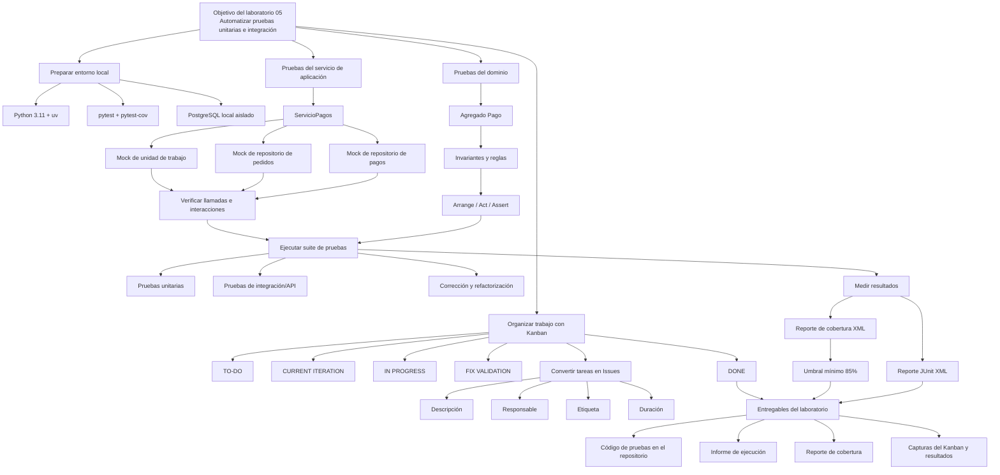

# Diagrama de realización de objetivos — Laboratorio 05

El siguiente flujo muestra cómo se cumplen los objetivos del laboratorio dentro de `SoftwareTextil`, desde la planificación Kanban hasta la evidencia final.



## Trazabilidad en el repositorio

| Objetivo | Implementación | Evidencia |
|---|---|---|
| Organizar el trabajo | `docs/lab05/kanban.md` y `kanban-import.csv` | Tablero y tarjetas |
| Probar reglas del dominio | `tests/pagos/test_pago_dominio.py` | Casos del agregado `Pago` |
| Probar servicios con dobles | `tests/pagos/test_servicio_pagos_doubles.py` | `Mock`, `MagicMock` y `create_autospec` |
| Probar integración y API | `tests/pagos/test_api_pagos.py` y `test_repositorio_pagos.py` | 54 pruebas aprobadas |
| Medir cobertura | `build/reports/coverage-lab05.xml` | 87.90% de cobertura |
| Reportar ejecución | `build/reports/pytest-lab05.xml` y `docs/lab05/informe-pruebas.md` | Informe JUnit y resumen |

## Comando que reproduce el flujo técnico

```bash
DB_NAME=software_textil_practica3 DB_PORT=55432 \
  docker compose -p softwaretextil-lab05 -f compose.practica3.yml up -d --wait db

DB_NAME=software_textil_practica3 DB_PORT=55432 DB_HOST=127.0.0.1 \
  uv run pytest tests/pagos \
  --cov=apps/ventas/pagos --cov-branch \
  --cov-report=xml:build/reports/coverage-lab05.xml \
  --junitxml=build/reports/pytest-lab05.xml
```
