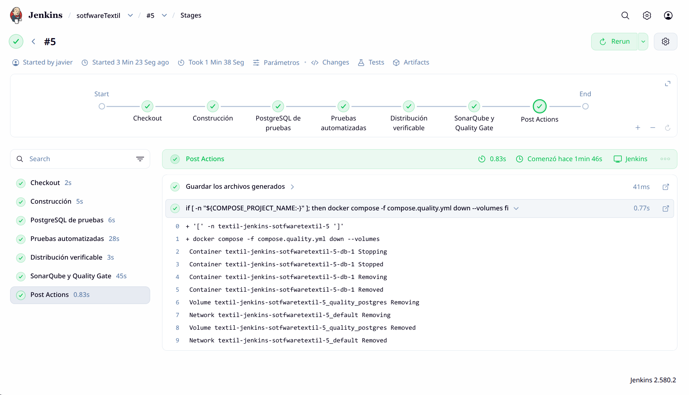

# Integración continua de SoftwareTextil en Jenkins

El `Jenkinsfile` del [PR #46](https://github.com/javierRock/SoftwareTextil/pull/46) está preparado para un job Pipeline desde SCM que construya la rama `dev`. La [matriz](matriz.md) contiene los hallazgos por módulo, responsable, prioridad y estrategia. La [trazabilidad](trazabilidad.md) enlaza los issues, el Kanban y los commits.

## Configuración del job

- Usar **Pipeline script from SCM**, el repositorio `javierRock/SoftwareTextil`, la rama `*/dev` y la ruta `Jenkinsfile`. Para validar el PR antes de integrarlo, usar otro job que lea `*/refactor/code-quality`.
- El agente necesita Git, Make, Docker Compose, uv, Python 3.11, Node 22.14.0, npm y SonarScanner CLI. Ejecutarlo en la misma máquina que [SonarQube local](http://localhost:9000/projects).
- Usar los plugins de Pipeline declarativo, Git, JUnit y Credentials Binding. Guardar el token del proyecto de CI en Jenkins como **Secret text** con ID `sonarqube-softwaretextil`.
- El escaneo está activado de forma predeterminada. `SONAR_PROJECT_KEY` apunta por defecto a `softwaretextil-dev-ci`, la clave reservada para el job de `dev`. Preparar esa clave en SonarQube y usar un token con permiso de análisis sobre ella. Para la comparación histórica utilizar el [proyecto separado](http://localhost:9000/dashboard?id=softwaretextil-refactoring-compare).

## Etapas y evidencias

| Etapa | Verificación | Evidencia |
| --- | --- | --- |
| Construcción | Instala las dependencias bloqueadas y construye React con Vite. | Salida de Jenkins y distribución del frontend. |
| PostgreSQL de pruebas | Levanta un proyecto Compose por ejecución y toma el puerto asignado por Docker. | Contenedor saludable. Jenkins retira el contenedor y el volumen de pruebas de esa ejecución al terminar. |
| Pruebas automatizadas | Django verifica la configuración y las migraciones. Pytest y Node ejecutan sus suites. ESLint revisa el frontend. | JUnit de Python y Node, cobertura Python en XML y HTML, y LCOV del cliente HTTP. |
| Distribución verificable | Recolecta estáticos, crea el ZIP y su SHA-256 y comprueba una copia extraída. | ZIP y checksum archivados en Jenkins. |
| SonarQube y Quality Gate | Importa XML y LCOV y espera el resultado del Gate. Una falla del análisis o del Gate falla el job. | Consola de Jenkins y dashboard de SonarQube. |

Las etapas ejecutan la construcción y las pruebas una sola vez. La distribución se archiva como evidencia de construcción. `make check` sigue disponible como verificación estricta de Ruff. [Configuración del scanner y del Quality Gate](https://docs.sonarsource.com/sonarqube-server/2025.2/analyzing-source-code/ci-integration/overview).

Para obtener el antes y el después, sigue la [guía de reproducción](ejecucion-local.md). Guarda la evidencia del análisis de `dev` antes de enviar el análisis posterior a la misma clave.

## Ejecución verificada el 23 de noviembre de 2026

Jenkins 2.580.2, build #3, ejecutó el commit `11fa65f` de `refactor/code-quality` desde un espejo Git local verificado con el mismo SHA publicado. Construyó la SPA con Node 22.14.0, validó configuración y migraciones de Django, y archivó la distribución después de verificar el ZIP y su checksum. Publicó **415 pruebas aprobadas y 0 fallidas**, incluidas 410 de Pytest y 5 de Node. Retiró el PostgreSQL aislado de esa ejecución al finalizar.

El scanner importó el XML y el LCOV generados por el job. La clave aislada `softwaretextil-jenkins-validation` tenía `a312d0a` como línea base. El build terminó en **FAILURE** porque SonarQube midió **55,2 %** de cobertura de código nuevo frente al **80 %** exigido. `make check` siguió deteniéndose en 58 diagnósticos de Ruff en una ejecución aparte.

[Consola del build](evidencias/jenkins-2026-11-23/consola.txt) · [Build y artefactos](evidencias/jenkins-2026-11-23/ejecucion.json) · [JUnit en Jenkins](evidencias/jenkins-2026-11-23/pruebas.json) · [Quality Gate de Jenkins](evidencias/jenkins-2026-11-23/quality-gate.json) · [Resultado de make check](evidencias/jenkins-2026-11-23/make-check-resumen.txt).

## Validación posterior en Jenkins

El 23 de noviembre de 2026, el build #5 de `sotfwareTextil` terminó en **SUCCESS**. Ejecutó el commit [`358879b`](https://github.com/javierRock/SoftwareTextil/commit/358879bbbc1d809b31902c60b7db07022a0b4120) de `refactor/code-quality` en Jenkins 2.580.2.

| Etapa | Resultado |
| --- | --- |
| Construcción y distribución | Jenkins construyó el frontend, verificó la distribución ZIP y archivó el paquete con su SHA-256. |
| Pruebas automatizadas | Pasaron 412 pruebas de Python y 6 de Node. Pytest-cov registró 85,27 % de cobertura global de Python. |
| Análisis SonarQube | El scanner importó el XML de Python y el LCOV de JavaScript. SonarQube devolvió `QUALITY GATE STATUS: PASSED` en el proyecto `softwaretextil-jenkins-validation`. |

El PR #46 sigue en revisión para `dev`. La [comparación antes y después](sonarqube-local.md#capturas-de-la-comparación) corresponde a dos análisis anteriores. Los jobs de backend y frontend también aprobaron en [GitHub Actions para el mismo commit](https://github.com/javierRock/SoftwareTextil/actions/runs/45305647561).
